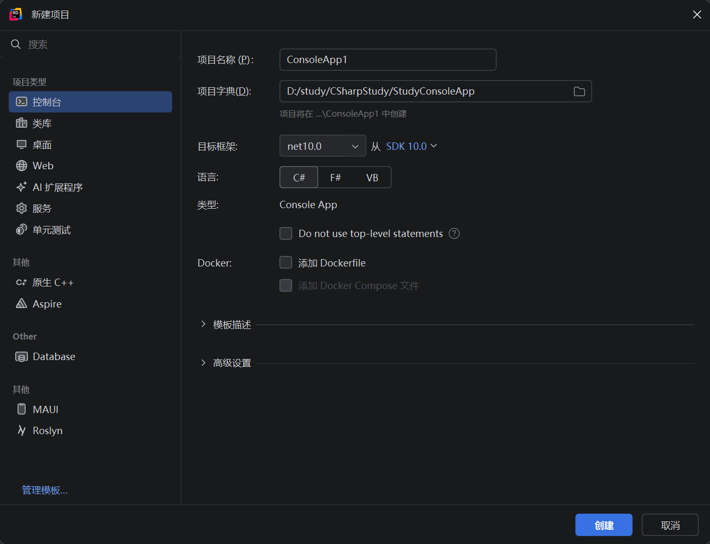
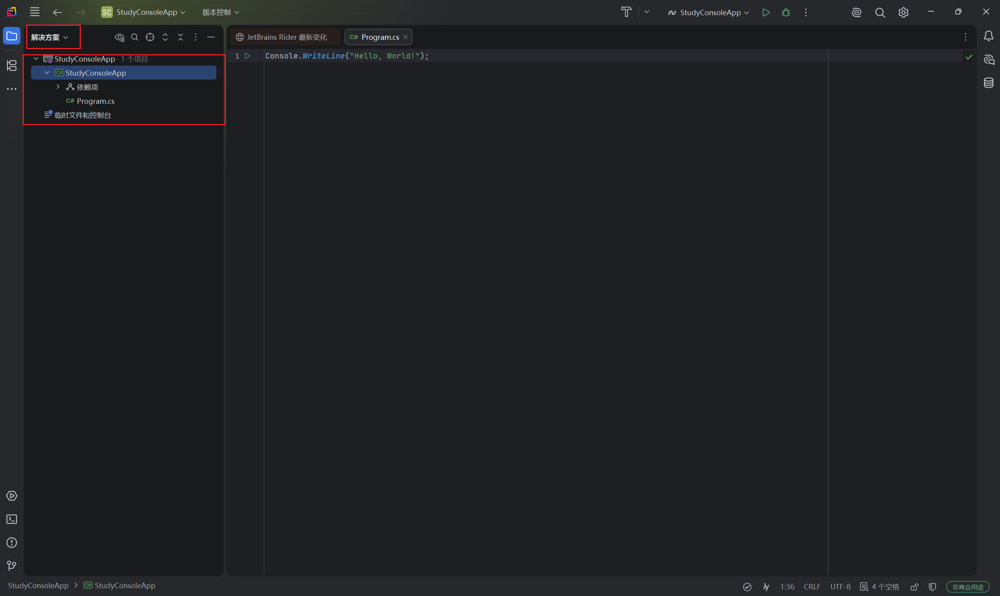
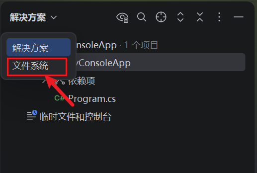

# C#基础笔记

## 一、C#概述与安装

`C#`是由微软开发的面向对象的编程语言，它是`.NET`框架的一部分，具有跨平台、运行效率高等特性。
`.NET`框架有较原始，适配Windows版本的，也有适用于全平台的，较原始的版本版本号低于5，而适配全平台的称为`.NET Core`，版本号从5开始。截止到本笔记编写，它的最新版本为`.NET 11.0`
当前.NET框架如果从微软官网直接下载安装程序的话，它是不支持自定义安装的，如果想自定义安装，可以使用命令行的方式进行安装:

~~~bash
    # 使用Invoke-WebRequest下载微软官方提供的dotnet-install脚本文件，并指定其下载位置
    Invoke-WebRequest -Uri "https://builds.dotnet.microsoft.com/dotnet/scripts/v1/dotnet-install.ps1" -OutFile "D:\dotnet-install.ps1"
    # 然后使用dotnet-install.ps1下载对应的.NET并指定其安装位置
    .\dotnet-install.ps1 -InstallDir D:\dotnet -Channel LTS -Architecture x64
    # 这段代码可以指定下载的版本
    .\dotnet-install.ps1 -InstallDir D:\dotnet -Version 8.0.400 -Architecture x64
~~~

---

## 二、HelloWorld

首先需要先创建一个项目，项目被包含在解决方案中，一个解决方案中可以存在多个项目，它们都从属于该解决方案。这类似于java的项目与模块。

其中最左侧的侧边栏中:
    控制台表示一个最基本的控制台程序项目
    类库表示一个需要被其它项目引用的项目，主要用来编写一些项目运行所必须且通用的代码
    桌面表示创建一个Windows APP程序项目
    Web表示创建一个后端项目
目标框架建议选择最新且LTS版本的，这个目标框架的意思是选择`.NET`的版本而不是`C#`的版本，`C#`的版本需要在`高级设置`中额外选择
创建完以后Rider默认呈现的并不是文件系统的文件显示模式，而是解决方案显示模式，在该显示模式下，部分文件系统的文件会被隐藏起来。

如果想查看全部的文件系统的文件，需要点击左上角的`解决方案`，选择`文件系统`切换显示模式

C#的HelloWorld需要具备如下条件:
  + 创建一个`.cs`为后缀的文件
  + 使用`namespace`关键字声明命名空间，高版本的C#支持在命名空间后加分号结束
  + 在命名空间中编写一个(或多个)`class`(类)
  + 在类中编写`Main`方法
  + 使用`Console.WriteLine()`方法输出

~~~C#
    namespace HelloWorld;
    public static class HelloWorld{
        public static void Main(string[] args){
            Console.WriteLine("Hello World!");
        }
    }
~~~

---

## 三、输入输出、注释与预处理指令

### （一）输入输出

C#使用`Console`类即可做到输入输出

|方法|参数|参数作用|作用|返回值类型|返回值|异常|备注|示例|
|:---:|:---:|:---:|:---:|:---:|:---:|:---:|:---:|:---:|
|WriteLine(string value)|value|要输出的字符串|输出字符串并自动换行|>|void|IOException|无|[示例](../源码/HelloWorld.cs)|
|Write(string value)|value|要输出的字符串|输出字符串|>|^|^|^|^|
|Read()|>|无参数|读取字符串，并返回第一个字符的unicode编码值|int|第一个字符的unicode编码值|^|^|^|
|ReadKey()|>|无参数|读取键盘上的键|>|带有三个枚举属性(Key、KeyChar、Modifiers)的元素|^|1.它不会等到按下空格才获取输入 2.它虽然会读取键盘上输入的值，但是却**没有将命令行上的输入移除**，如果此时再使用Read()之类的方法读取输入，**可能会读取到空串**|^|
|ReadLine()|>|无参数|读取输入的字符串|string|输入的字符串|^|无|^|

---

### （二）注释

C#的注释与java类似，只是文档注释有些不一致。C#的文档注释是三个`/`，即`///`来表示这是一段文档注释，并使用一些标签来详细描述文档

|标签名|作用|标签属性|属性作用|备注|示例|
|:---:|:---:|:---:|:---:|:---:|:---:|
|summary|描述类、方法、属性等的简要说明|无||无|[示例](../源码/HelloWorld.cs)|
|param|方法参数的说明|name|方法参数的名字|^|^|
|returns|方法返回值的说明方法返回值的说明|无||^|^|
|exception|方法异常说明方法异常说明|cref|具体的异常引用，即该异常的全类名|^|^|
|remarks|补充说明补充说明|无||^|^|
|example|在文档注释中写一些示例代码，写代码的时候需要使用`<code>`标签包起来在文档注释中写一些示例代码，写代码的时候需要使用`<code>`标签包起来|^|^|^|^|
|code|需要在`<example>`标签中使用，用于将示例代码包起来需要在`<example>`标签中使用，用于将示例代码包起来|^|^|^|^|
|seealso|相关的引用参考信息相关的引用参考信息|cref|引用的对应类的全类名|^|^|
|value|描述成员属性的的值描述成员属性的的值|^|^|^|^|
|typeparam|泛型类型的参数泛型类型的参数|无||^|^|

---

### （三）预处理指令

C#提供了许多的预处理指令供我们使用，不过使用预处理指令需要一些条件:
1. 一些预处理指令必须有开始也要有结束，像`#if`和`#endif`
2. 一些预处理指令需要在同一个代码块或其子代码块作用域下才能生效，不能跨过其最外层代码块使用

|指令|作用|备注|示例|
|:---:|:---:|:---:|:---:|
|`#define`|定义一个符号变量|**必须放在文件的开头位置，且不能定义有值的常量**，只能定义简单的符号变量|[示例](../源码/HelloWorld.cs)|
|`#undef`|取消定义|无|^|
|`#if`|配合自定义符号可以条件编译代码块|^|^|
|`#elif`|^|^|^|
|`#else`|^|^|^|
|`#endif`|条件预处理指令的结束|^|^|
|`#region`|定义代码块区域，便于折叠|^|^|
|`#endregion`|代码块区域定义的结束|^|^|
|`#warning`|编译器会弹出警告|^|^|
|`#error`|编译器会弹出错误|^|^|
|`#line`|修改编译器当前的行号和文件名信息|^|^|
|`#pragma`|提供编译器特定的指令|^|^|
|`#nullable`|控制可空引用类型的上下文(**C# 8.0引入**)|^|^|

---

## 四、基本数据类型

|数据类型|作用|范围|备注|
|:---:|:---:|:---:|:---:|
|byte|无符号8位整数|0~255|无|
|sbyte|有符号8位整数|-128~127|^|
|short|有符号16位整数|略|^|
|int|有符号32位整数|略|^|
|long|有符号64位整数|略|^|
|float|单精度32位浮点数|略|^|
|double|双精度64位浮点数|略|^|
|char|16位unicode字符|略|^|
|bool|布尔值|true和false|^|
|ushort|无符号16位整数|略|^|
|uint|无符号16位整数|略|^|
|ulong|无符号16位整数|略|^|
|decimal|高精度无误差128位浮点数|略|^|

这些基本数据类型的拆箱与装箱和java基本一致，不过C#的ushort可以直接和char互相转换，因为它们都是无符号16位的，不过java就不行，只能用int
decimal可以接收所有整型基本数据类型的值，但是不能接收浮点类型的值

---

## 关键字与特殊运算符

一些基础运算符，如逻辑运算符、算术运算符等与java是一致的

|关键字|作用|备注|
|:---:|:---:|:---:|
|const|定义编译时常量，必须在声明的时候就赋值|无|
|readonly|定义运行时常量，可以在构造器或者声明时赋值|无|
|is|用于判断对象所属的类型、对象的值或者对象是否为空|**is在逻辑运算中只能使用一次，且必须写在开头**|
|when|用于在case语句中对附加的新变量进行额外的逻辑判断|例:`case int n when n >10 && n <= 20`|
|and、or、not|通常和is搭配使用，因为is不能和逻辑运算符一起用|无|
|foreach|增强for循环声明|无|
|in|用于在增强for循环中遍历迭代器|无|

|运算符|作用|用法|备注|
|:---:|:---:|:---:|:---:|
|`??`|空合并运算符，当左边的值为空时返回右边的值，否则返回原值|`int a = b??c;`|无|
|`?.` / `?[index]`|空条件运算符，当左边的值不为null时才继续执行后续方法或索引器等特殊符号|1.调用方法的情况:`a?.test();` 2.使用下标的情况`a?[1]`|无|
|`!.` / `![index]`|空抑制运算符，用于抑制编译器该值可能为空的警告|1.调用方法的情况:`a!.test();` 2.使用下标的情况`a![1]`|无|
|`type ?`|空类型运算符，表示声明的该类型的对象可以为空|`String? str=null;`|无|

---

## 、流程控制

### 判断语句

判断语句可以分为if-else if-else语句和switch语句，和java一致，此处重点说明switch表达式
switch表达式于C#8.0开始被引入，它是一种带返回值的swith语句，它的写法是:

~~~C#
    // 语法
    {parameter} = {switchParameter} switch{
        {value1} => {returnValue},
        {type} => {returnValue},
        _ => {returnValue}
    };
    // 样例
    var a = "aaa";
    var b = a switch {
        "aaa" => 1,
        _ => 0,
    };
~~~

### 模式匹配

模式匹配机制于C#7.0被引入，可以更便捷的进行各种模式判断

#### is表达式

is表达式可以判断变量的值、所属类型、是否为空并进行后续操作，例:

~~~c#
    // 最简单的is表达式写法
    if(obj is int){...}
    // 判断非空
    if(obj is not null){...}
    // 判断常量
    if(obj is 1){...}
    // 如果是String类型，那么将obj的值赋值给i，并在接下来的代码块中使用i进行相关操作
    if(obj is String i){Console.WriteLine(i);}
    // is,not,and和or结合起来的写法，需要注意is在一次if判断中只能写一次，不能重复的写is
    if (a is int and (<=10 or >=18) and not 7){...}
~~~

---

#### 比较关系符

即使用switch-case语句进行值的比较，它**只能用在switch-case语句中**

~~~c#
    int a = 10;
    switch (a) {
        case >=10:Console.WriteLine("是大于0的数"); break;
        _: break;
    }
~~~

---

#### 位置模式

位置模式可以针对元组或解构对象，将对象中指定位置中的值拿出来进行一些匹配操作

~~~c#

    class Point {
        public int X { get; }
        public int Y { get; }
        public Point(int x, int y) => (this.X, this.Y) = (x, y);
        
        public void Deconstruct(out int x, out int y) => (x, y) = (this.X, this.Y);
    }

    Point point = new Point(1, 2);
    if (point is (1, 2)) {
        Console.WriteLine("The Point is (1,2)");
    }
~~~

---

#### 属性匹配

属性匹配于C#8.0开始支持，它可以直接指定对象的属性值进行匹配，例:

~~~c#
    class Point {
        public int X { get; set; }
        public int Y { get; set; }
    }
    Point point = new Point{X = 1, Y = 2};
    // 会输出匹配成功，因为它只是比较该对象里面的X是否一致，而代码没写Y,所以它也不会管
    if (point is { X:1 }) {
        Console.WriteLine("匹配成功！");
    }
~~~

---

#### 列表模式

列表模式于C#11.0被引入，它用于检查元素是否匹配对应的嵌套模式，例:

~~~c#
    var number1 = new[] { 1, 2, 3, 4, 5 };
    var number2 = new[] { 1, 2 };
    switch (number1, number2) {
        case ([var leftFirst, ..], [var rightFirst, ..]):  Console.WriteLine($"第一个值{leftFirst},第二个值:{rightFirst}");break;
        case([],[var rightFirst, ..]):  Console.WriteLine("左侧数组为空数组");break;
        case([var leftFirst,..],[]): Console.WriteLine("右侧数组为空数组");break;
    }
~~~

### 循环语句

C#的循环语句与java基本一致，除了增强for循环:

~~~c#
    int[] a = new int[] { 1, 2, 3, 4, 5 };
    // C#的增强for循环关键字是foreach，且使用in关键字进行遍历
    foreach (int i in a) {
        Console.WriteLine(i);
    }
~~~

---

## 、异常处理

---

## 、面向对象

## 、泛型

---

## 、多线程

---

## 、反射

---

## 、文件与IO

## 常用类

### 字符串

在C#中，字符串(String)可以用两种方式定义类型，即`string`和`String`，无论`s`是否大小写，都相当于定义字符串类型的变量
下面是字符串的常用方法:

|方法/属性|参数|参数作用|作用|返回值|返回值类型|异常|备注|
|:---:|:---:|:---:|:---:|:---:|:---:|:---:|:---:|
|Length|无||返回长度|长度|int|无|**这是属性**|
|this[int index]{get}|index|下标|获取指定下标的字符|字符|char|^|无|
|IndexOf(String str)|str|要查找的字符串|查找字符串，如果有多个返回第一个的下标，没有返回-1|下标|int|^|^|
|LastIndexOf(String str)|str|要查找的字符串|从后往前找返回第一个找到的字串下标，没有返回-1|下标|int|^|^|
|Substring(int start,int end?)|start|切片起始下标|切片|切片后的字符串|String|^|^|
|^|end|切片结束下标，可选|^|^|^|^|^|
|Replace(char oldChar,char newChar)|oldChar|要被替换的字符|替换字符串中的指定字符|返回替换后的字符串|^|^|^|
|^|newChar|要替换上去的字符|^|^|^|^|^|
|Replace(String target,String replacement)|target|要被替换的字符串|替换字符串中的指定子串|返回替换后的字符串|^|^|^|
|^|replacement|要替换上去的字符串|^|^|^|^|^|
|ToUpper()|无||所有字符转大写|转换后的字符串|^|^|^|
|ToLower()|无||所有字符转小写|^|^|^|^|
|Trim()|无||去除字符串开头和结尾的多余空格|^|^|^|^|
|Equals(Object obj)|obj|要比较的对象|比较两个字符串是否相等|布尔值|bool|^|^|
|EqualsIgnoreCase(String anotherStr)|anotherStr|要比较的对象|忽略大小写比较两个字符串是否相等|布尔值|bool|^|^|
|StartsWith(String prefix)|prefix|要判断的开头字符串|判断字符串是否以指定开头开始|布尔值|bool|^|^|
|EndsWith(String suffix)|suffix|要判断的结尾字符串|判断字符串是否以指定结尾结束|布尔值|bool|^|^|
|Contains(String s)|s|要判断的字符串|判断字符串是否包含指定子串|布尔值|bool|^|^|
|Split(params char[] separator)|separator|要分割该字符串的字符组成的数组|根据指定的分割符对字符串进行分割|分割后的字符串数组|String[]|^|^|
|ToCharArray()|无||返回字符串的字符数组|字符数组|char[]|^|^|
|CompareTo(Object value)|value|要比较的值|比较两个字符串的值|大于返回大于0，小于返回小于0，等于返回0|int|^|^|
|static IsNullOrEmpty()|无||判断字符串是否为空串或为空|布尔值|bool|^|^|
|static IsNullOrWhiteSpace()|无||判断字符串是否为空或全为空白字符|布尔值|bool|^|^|
|static intern(String str)|str|需要被放入字符串常量池的字符串对象|将指定的字符串对象放入字符串常量池|其对应的字符串常量池中的引用|String|^|^|

#### 插值表达式

如下例所示，跟JS的插值表达式差不多

~~~C#

int a=1;
int b=2;

String str=$"{a},{b}"

~~~

---

#### StringBuilder

|方法/属性|参数|参数作用|作用|返回值|返回值类型|异常|备注|
|:---:|:---:|:---:|:---:|:---:|:---:|:---:|:---:|
|Length{get,set}|无||设置或获得当前字符串的长度|当前字符串的长度||无|**这是属性**|
|Capacity{get,set}|无||设置或获得当前字符串的容量|当前字符串的容量||^|^|
|this[int index]{get, set}|index|想获取的字符的索引|得到指定索引的字符|下标对应的字符||^|无|
|EnsureCapacity(int capacity)|capacity|指定字符串容量|确保当前容量至少为指定值|当前字符串操作后的新容量大小||^|^|
|Append(Object obj)|obj|要插入的值|添加对应的值进入字符串|this|StirngBuilder|^|^|
|AppendLine(String str?)|str|要插入的值|添加对应的值进入字符串并换行|^|^|^|也可以不传参数，单纯换行|
|AppendFormat(String format,params Object[] args)|format|字符串格式化模板|将对应参数格式化后添加进字符串|^|^|^|无|
|^|args|要添加进格式化模板的参数|^|^|^|^|^|
|Insert(int index,String value)|index|想插入的下标|向指定位置插入字符串|^|^|^|^|
|^|value|要插入的字符串值|^|^|^|^|^|
|Remove(int index,int length)|index|开始删除的下标|从对应的下标位置开始，删除length个字符|^|^|^|^|
|^|length|删除的个数|^|^|^|^|^|
|Replace(String oldValue,String newValue,int startIndex?,int count?)|oldValue|需要被替换的字符串|替换指定字符串，若指定了替换范围，则只在替换范围内替换|^|^|^|^|
|^|newValue|替换后的字符串|设置或获得当前字符串的长度|^|^|^|^|
|^|startIndex|替换范围的开始下标，可选|设置或获得当前字符串的长度|^|^|^|^|
|^|count|替换范围的长度，可选|设置或获得当前字符串的长度|^|^|^|^|

---

### （一）Console

### （二）Convert

Convert类专门提供了一些前缀为`Toxxx`的方法来让我们进行基本数据类型的转换

---

