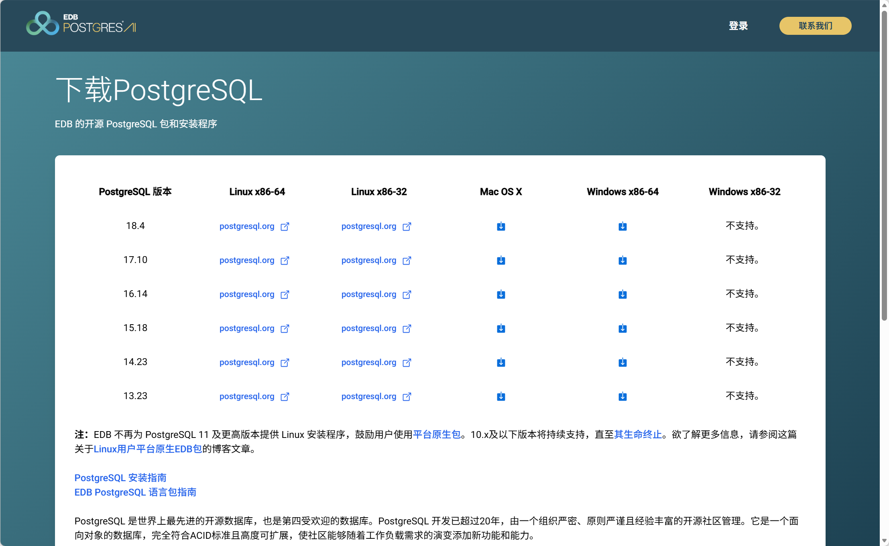

# 基础

## 一、概述

## 二、安装

**这是Windows系统的安装攻略**
进入[官网](https://www.postgresql.org/)找到download一路点进去，或者点击[这里](https://www.enterprisedb.com/downloads/postgres-postgresql-downloads)来进行下载，最终都会到达这个界面，选择自己对应的系统下载，可以看到**高版本的pgSQL都不支持win32位系统**。

下载完安装器以后，点击该安装器打开安装程序，主要就是**修改两个安装目录**（第一个是数据库的安装目录，第二个是数据库存储的数据的存储目录）以及**设置数据库的密码**，别的都自定义即可